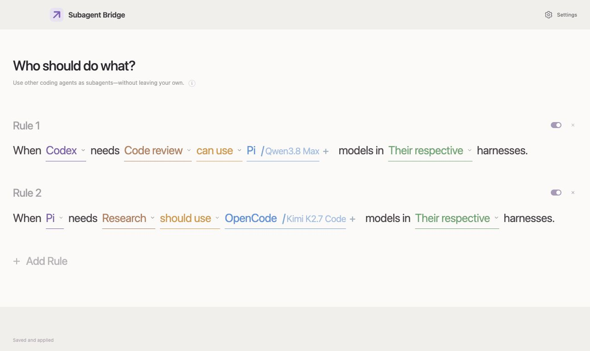

# Subagent Bridge

**Your favorite agents. Now your subagents.**

Let the coding agent you're working with ask another agent for help. Choose who can help, which model to use, and when to delegate. Each subagent uses its own tools and provider settings, in your current project folder.

[Website](https://tarachand-gupta.github.io/subagent-bridge-site/) · [Download for macOS](https://github.com/Tarachand-Gupta/subagent-bridge/releases/tag/v0.3.1) · [Documentation](docs/README.md)



*The app's rule editor, shown with an example configuration.*

## A rule is a sentence

> When Codex needs a code review, it can use Pi with Qwen3.8 Max and High thinking.

Pick a model available in your agent's account. Use **can use** to let your agent decide, or **should use** to ask it to delegate matching tasks. Multiple selections are alternatives; the agent chooses one per task.

The subagent works in the background while you continue. Follow up in the same worker conversation while its session is alive. [How results come back →](docs/integrations.md#parent-integrations)

## Get started

You'll need **Node.js 22.13+** and the coding agents you want to connect, already installed and configured.

1. [Download the app](https://github.com/Tarachand-Gupta/subagent-bridge/releases/tag/v0.3.1) and move it to Applications.
2. Add a rule. Choose a task, subagent, model, and thinking level, then enable it.
3. Click **Save Rules and Apply** and follow any connection or reload instructions.

The macOS preview is for Apple Silicon, macOS 12+. It is ad-hoc signed and not notarized. [Installation and first-launch help →](docs/install-macos.md)

<details>
<summary>Prefer the terminal?</summary>

Download the CLI `.tgz` from the same release, then:

```sh
npm install --global ./subagent-bridge-local-0.3.1.tgz
subagent-bridge config edit
subagent-bridge config preview
subagent-bridge config apply
```

The CLI and desktop app share the same rules and saved draft. See the [CLI guide](docs/cli.md) for editor setup, import/export, and scripting.

</details>

<a id="parent-integrations"></a>
<a id="compatibility-and-maintenance"></a>

## Which agents work?

**Codex, Pi, OpenCode, and DeepSeek** have native orchestrator integrations. An ACP catalog helps discover additional subagents, including Claude Code, Gemini CLI, and others. Catalog entries aren't a promise of live-tested support.

See [tested versions and connection details](docs/integrations.md). Windows and Linux installers are not available yet.

<details>
<summary>A few things to know</summary>

- Workers inherit the current project folder; pass the context they need. Full chat history isn't copied.
- Codex receives results during an active turn or on the next turn; Bridge doesn't wake an idle chat.
- Worker conversations last while their owning service is alive. They don't survive a restart.
- Bridge runs locally. Model access, billing, and permissions stay with each agent and its provider.
- Upgrading from Harness Bridge? Keep `~/.harness-bridge` intact. [Upgrade notes →](docs/usage.md#existing-installations)

</details>

## Go further

- [Using the app](docs/usage.md) — rules, prompt previews, import/export, and configuration MCP.
- [CLI guide](docs/cli.md) — use the same configuration from your terminal.
- [Agent integrations](docs/integrations.md) — versions, delivery, and limits.
- [Development](docs/development.md) — build, test, and contribute.
- [Release notes](docs/releases/v0.3.1.md) · [Report a bug](https://github.com/Tarachand-Gupta/subagent-bridge/issues)

[MIT license](LICENSE).
